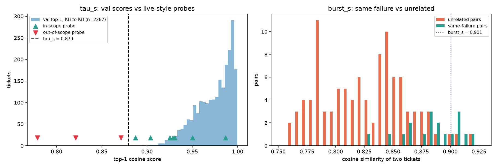

# tau_s: minimum top-1 similarity for a usable precedent

**tau_s = 0.879**, **burst_s = 0.901** (burst_N = 3, burst_T_min = 15 are team defaults). Written to config/thresholds.json.

- tau_s: midpoint of the gap between out-of-scope (max 0.871) and in-scope (min 0.887) probes, capped at the val p10 (0.946).
- Embeddings `intfloat/multilingual-e5-base`, cosine. Index: 22,869 KB rows (22,780 usable).
- Val: 2287 val tickets, each searched with itself excluded. Top-1 percentiles 5/10/25/50/75/90: 0.937, 0.946, 0.961, 0.979, 0.991, 0.996. At tau_s, 100% of val tickets have a precedent.
- KB-to-KB scores are inflated (templated dataset); hand-typed tickets score lower, so tau_s sits below the val median and is checked against probe tickets scored through the real path.
- In-scope probes (must stay above tau_s):
  - `ADV-19`: 0.887
  - `ADV-18`: 0.904
  - `ADV-12`: 0.925
  - `ADV-13`: 0.929
  - `ADV-11`: 0.931
  - `ADV-24`: 0.950
  - `ADV-23`: 0.987
- Out-of-scope probes (must fall below tau_s):
  - `ADV-15`: 0.779
  - `ADV-14`: 0.821
  - `ADV-16`: 0.871
- burst_s: WARNING same-failure min (0.828) <= unrelated max (0.918); midpoint of unrelated max and same-failure mean. Same-failure pairs: 18, unrelated pairs: 102.
- Gate rule: escalate with `NO_PRECEDENT` when the best score is below tau_s. A single score separates in-scope from out-of-scope by only a small margin, so NO_PRECEDENT is one signal among several in the gate.

